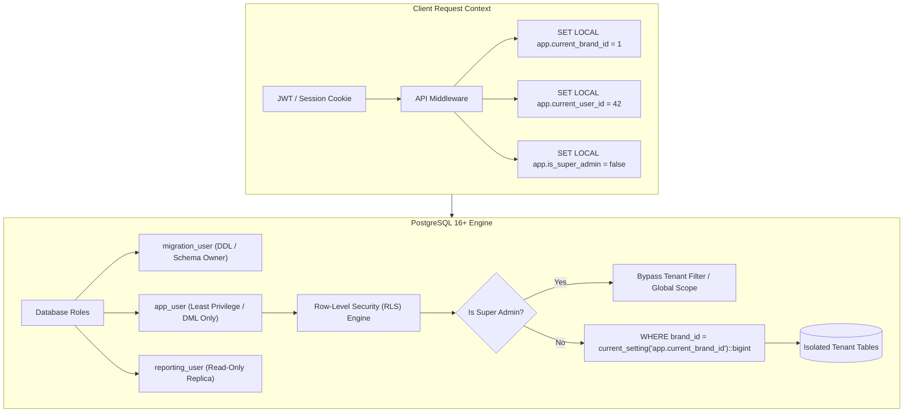
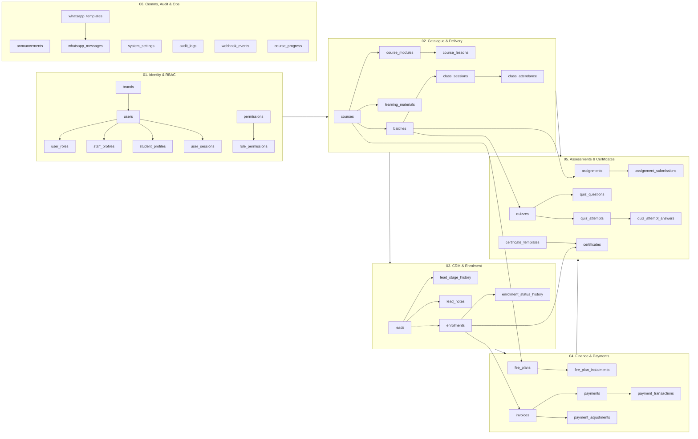

# Architecture Overview & System Blueprint
**Project:** Shared Multi-Brand LMS & Admissions CRM (`TeluguAI.com` & `GenAI99.com`)  
**Scope:** Tenancy, Security, Relational Modeling, Overlap Resolutions, and PostgreSQL Standards  
**Target:** PostgreSQL 16+ (Mandatory UTF-8 for Vernacular Telugu)  
**Document Code:** `/database/04_architecture_overview.md`

---

## 1. Executive Summary

This architecture establishes an enterprise-grade, multi-tenant database for the unified `TeluguAI.com` (vernacular Telugu tech academy) and `GenAI99.com` (global enterprise AI bootcamps) platform. Reverse-engineered from the complete front-end codebase, this schema satisfies both domestic Indian operational workflows (INR, Razorpay, WhatsApp Meta Cloud API, UPI) and global market demands (USD, Stripe, international phone numbers).

### Core Metrics at a Glance
- **Target Engine:** PostgreSQL 16+ (verified compatible with PostgreSQL 18)
- **Encoding:** UTF-8 (`te_IN` collation support for Telugu indexing)
- **Total Relational Tables:** **42 normalized tables** across 10 functional domains (consolidated from an unverified 56-table baseline)
- **Tenancy Architecture:** Shared Database, Shared Schema with **Row-Level Security (RLS)** and composite tenancy foreign keys
- **Security & RBAC:** Decoupled Authentication (`users`) from Brand Roles (`user_roles`) and Profiles (`staff_profiles`, `student_profiles`)
- **Extensions Utilized:** `citext`, `pgcrypto`, `btree_gist`, `pg_trgm`

---

## 2. Multi-Tenancy & Security Model



### 2.1 Multi-Tenancy Strategy
- **Shared Database, Shared Schema:** All tenants reside within a single PostgreSQL database and default `public` schema.
- **Tenant Discriminator:** Every tenant-owned table contains `brand_id bigint NOT NULL REFERENCES brands(brand_id) ON DELETE RESTRICT`.
- **Hierarchical Tenancy Enforcement:** To prevent cross-brand reference leakage, child tables repeat `brand_id` and enforce consistency using composite foreign keys:
  ```sql
  -- Example: A class session must belong to the exact same brand as its batch
  ALTER TABLE class_sessions 
    ADD CONSTRAINT fk_class_sessions_batch_tenant 
    FOREIGN KEY (brand_id, batch_id) 
    REFERENCES batches (brand_id, batch_id) 
    ON DELETE RESTRICT;
  ```

### 2.2 Row-Level Security (RLS) Policies
Row-Level Security is enabled on all tenant-owned tables (`ALTER TABLE <table> ENABLE ROW LEVEL SECURITY;`).

#### Session Context Variables
- `app.current_brand_id`: Active brand (`bigint` identifier corresponding to `teluguai` or `genai99`).
- `app.current_user_id`: Authenticated user's `bigint` primary key.
- `app.is_super_admin`: Boolean flag (`true` / `false`).

#### Standard Tenant Isolation Policy Template
```sql
CREATE POLICY tenant_isolation_policy ON <table>
  FOR ALL
  TO app_user
  USING (
    current_setting('app.is_super_admin', true) = 'true'
    OR
    brand_id = NULLIF(current_setting('app.current_brand_id', true), '')::bigint
  )
  WITH CHECK (
    current_setting('app.is_super_admin', true) = 'true'
    OR
    brand_id = NULLIF(current_setting('app.current_brand_id', true), '')::bigint
  );
```

### 2.3 Database Roles & Privileges
1. **`migration_user`**: Schema owner with DDL privileges. Executes database migrations, alters tables, manages indexes, and defines RLS policies. Disallowed from handling application runtime connections.
2. **`app_user`**: Runtime application user with least-privilege DML (`SELECT`, `INSERT`, `UPDATE`, `DELETE`) on tables and sequences. Does **NOT** hold `SUPERUSER` or `BYPASSRLS`. Subject to RLS at all times.
3. **`reporting_user`**: Read-only user (`SELECT` only) connecting to read-replicas for analytical queries, business intelligence, and materialized view maintenance.

### 2.4 Privacy & India DPDP Act Compliance
- **PII Columns Classification:**
  - `users.email`, `users.phone`, `users.full_name`
  - `student_profiles.whatsapp_number`, `student_profiles.city_or_region`
  - `leads.phone`, `leads.email`, `leads.discussion_notes`
  - `class_attendance.remarks`
- **Data Minimization & Retention:**
  - Unconverted leads older than 180 days with no activity are purged or anonymized via a scheduled maintenance worker.
  - Student academic and financial records are permanent and **never** hard deleted.
- **Auditability:** Every access and administrative modification is logged in `audit_logs` with actor details, client IP address, and JSON before/after snapshots.

---

## 3. Conventions & Standards

| Standard | Rule & Specification | Justification |
|---|---|---|
| **Naming Conventions** | `snake_case`, plural table names (`courses`, `class_sessions`), singular foreign keys (`course_id`, `batch_id`). | Industry-standard PostgreSQL convention for maximum tooling compatibility. |
| **Primary Keys** | Internal `bigint GENERATED ALWAYS AS IDENTITY PRIMARY KEY` + Public `uuid DEFAULT gen_random_uuid() UNIQUE`. | High-performance B-tree clustering and sequential indexing internally; non-guessable, secure identifiers in client URLs and APIs. |
| **Monetary Amounts** | `numeric(12,2) NOT NULL` + `currency varchar(3) NOT NULL` (e.g. `'INR'`, `'USD'`). | Floating-point rounding errors are strictly prohibited in financial ledgers. |
| **Timestamps** | `timestamptz NOT NULL DEFAULT clock_timestamp()`. All timestamps stored in UTC. | Preserves timezone accuracy across IST (+05:30) and global student cohorts. |
| **Audit Columns** | `created_at`, `updated_at` on all tables; `created_by`, `updated_by` (`FK -> users(user_id)`) where human action is taken. | Full traceability across CRM, finance, and curriculum authoring. |
| **String Normalization**| Email columns use `citext` (case-insensitive); Phone numbers stored normalized in E.164 format (e.g. `+919848012345`). | Prevents duplicate accounts resulting from case mismatches or formatting variations. |
| **Deletes & Cascades** | Default `ON DELETE RESTRICT` on all business relationships; `ON DELETE CASCADE` restricted strictly to dependent sub-items (e.g., `quiz_questions` under `quizzes`). Hard deletion is prohibited on academic and financial ledgers. | Prevents accidental data loss and orphan financial records. |

---

## 4. Domain Grouping & Final 42-Table Inventory

The schema is divided into 10 cohesive relational domains:



### Complete 42-Table Registry

| # | Table Name | Domain | Primary Purpose & Code Mapping |
|---|---|---|---|
| 1 | `brands` | Core Identity | Tenant definitions (`TeluguAI.com`, `GenAI99.com`). |
| 2 | `users` | Core Identity | Global authentication accounts and password credentials. |
| 3 | `user_brand_access` | Core Identity | User tenant membership junction. |
| 4 | `user_roles` | Core Identity | Brand-scoped role assignments (`super_admin`, `admin`, `counselor`, `trainer`, `student`). |
| 5 | `permissions` | Core Identity | 12 platform capabilities catalog. |
| 6 | `role_permissions` | Core Identity | Configurable role-permission assignment matrix. |
| 7 | `staff_profiles` | Core Identity | Staff operational attributes (specializations, counselor lead loads). |
| 8 | `student_profiles` | Core Identity | Learner demographics and emergency WhatsApp contacts. |
| 9 | `user_sessions` | Core Identity | Active JWT/session token store with inactivity timeouts. |
| 10 | `courses` | Course Catalogue | Academic programs and master syllabi. |
| 11 | `course_modules` | Course Catalogue | Syllabus chapter modules. |
| 12 | `course_lessons` | Course Catalogue | Individual learning units with video URLs and Telugu code snippets. |
| 13 | `learning_materials` | Course Catalogue | S3 file metadata (slides, notebooks, cheatsheets, code repos). |
| 14 | `batches` | Cohorts & Timetable| Academic cohort cohorts, schedules, and capacity limits. |
| 15 | `class_sessions` | Cohorts & Timetable| Scheduled live lectures, Google Meet/Zoom links, and replays. |
| 16 | `class_attendance` | Cohorts & Timetable| Daily student presence ledger (`present`, `late`, `absent`) and streaks. |
| 17 | `leads` | Admissions CRM | Candidate inquiry pipeline cards. |
| 18 | `lead_stage_history` | Admissions CRM | 5-stage funnel transition audit trail. |
| 19 | `lead_notes` | Admissions CRM | Counselor discussion logs and candidate preferences. |
| 20 | `enrolments` | Student Enrolment | Official binding between student, course, and assigned cohort. |
| 21 | `enrolment_status_history`| Student Enrolment| Academic enrollment lifecycle states (`active`, `completed`, `dropped`). |
| 22 | `fee_plans` | Finance & Invoicing| Pricing structures (Full Upfront vs Multi-part Installments). |
| 23 | `fee_plan_instalments` | Finance & Invoicing| Individual installment due schedules and breakdown amounts. |
| 24 | `invoices` | Finance & Invoicing| Snapshot tuition bills, billed amounts, due dates, and statuses. |
| 25 | `payments` | Finance & Invoicing| Append-only business money receipts (`REC-TAI-2026-081`). |
| 26 | `payment_transactions` | Finance & Invoicing| Gateway webhook events (Razorpay/Stripe raw payloads). |
| 27 | `payment_adjustments` | Finance & Invoicing| Refunds, scholarship waivers, and discount corrections. |
| 28 | `assignments` | Assessments | Capstones and homework specifications with starter GitHub URLs. |
| 29 | `assignment_submissions`| Assessments | Student GitHub code submissions, marks, and written critique. |
| 30 | `quizzes` | Assessments | MCQ examination definitions and pass thresholds. |
| 31 | `quiz_questions` | Assessments | Questions, JSON option arrays, and correct answer keys. |
| 32 | `quiz_attempts` | Assessments | Student test attempt scores and completion timestamps. |
| 33 | `quiz_attempt_answers` | Assessments | Student-selected answers per question for review mode. |
| 34 | `course_progress` | Progress & Creds | Persistent materialized progress summaries for sub-50ms dashboards. |
| 35 | `certificate_templates` | Progress & Creds | Brand visual credentials, titles, and authorized signatures. |
| 36 | `certificates` | Progress & Creds | Verifiable completion credentials (`CERT-TAI-8921`) with public UUIDs. |
| 37 | `announcements` | Communications | Broadcast notices to cohorts and campus communities. |
| 38 | `whatsapp_templates` | Communications | Meta Cloud API approved templates (`lead_welcome`, `fee_receipt`). |
| 39 | `whatsapp_messages` | Communications | Outbound notification logs and absentee alert dispatches. |
| 40 | `system_settings` | Ops & Security | Encrypted API keys, payment secrets, S3 bucket names, and 2FA policies. |
| 41 | `audit_logs` | Ops & Security | Append-only security audit trail partitioned monthly. |
| 42 | `webhook_events` | Ops & Security | Idempotent incoming webhook queue. |

---

## 5. Key Design Decisions & Rationale

### Decision 1: Exclusion Constraints for Faculty Scheduling
- **Problem:** Trainers must not be double-booked into concurrent live lectures across different cohorts.
- **Solution:** Utilize the PostgreSQL `btree_gist` extension to establish an exclusion constraint on `class_sessions`:
  ```sql
  ALTER TABLE class_sessions
    ADD CONSTRAINT prevent_trainer_double_booking
    EXCLUDE USING gist (
      trainer_id WITH =,
      tstzrange(scheduled_start, scheduled_end) WITH &&
    ) WHERE (status != 'cancelled');
  ```
- **Rationale:** Application-level validation is subject to race conditions under concurrent scheduling. The database engine guarantees mathematical overlap prevention at the transaction serialization level.

### Decision 2: Financial Immutability (Invoices vs Payments vs Adjustments)
- **Problem:** Payment modifications or fee overrides destroy financial audit trails.
- **Solution:** 
  1. `invoices` represents the snapshot claim of money owed.
  2. `payments` is an append-only ledger of verified money receipts.
  3. Corrective actions (refunds, scholarship waivers, discount adjustments) never delete or mutate prior payments; they insert signed adjustment rows in `payment_adjustments`.
- **Rationale:** Strict adherence to double-entry accounting standards and tax audit compliance.

### Decision 3: Hybrid Architecture for Course Progress
- **Problem:** Real-time calculation of student progress (attendance %, assignments completed, quiz average) requires multi-table aggregations that degrade dashboard loading speeds.
- **Solution:** 
  1. Canonical business logic is defined in an authoritative SQL View (`v_student_course_progress`).
  2. A persistent summary table (`course_progress`) stores current student performance metrics and is updated synchronously or asynchronously on grading/attendance triggers.
- **Rationale:** Delivers sub-50ms dashboard page loads for students and trainers while maintaining single-source-of-truth mathematical formulas.

---

## 6. Rejected Alternatives

| Alternative Considered | Rejection Rationale |
|---|---|
| **Database-per-tenant or Schema-per-tenant** | Managing 2 distinct databases or schemas creates massive migration overhead, complicates cross-brand analytics, and breaks the UI requirement where staff toggle brands within the same session. |
| **Native PostgreSQL ENUM Types** | Native ENUMs in PostgreSQL require DDL locks to alter, cannot be easily soft-deprecated, and fail to store metadata (descriptions, display colors). `CHECK` constraints and lookup reference tables were adopted instead. |
| **Storing Files as BLOBs (`bytea`)** | Binary payloads in relational databases inflate backup sizes, degrade WAL performance, and saturate connection bandwidth. Only S3 metadata and object keys are stored. |
| **Strict Gap-Free Invoice Sequences** | Enforcing strict sequential invoice numbering across concurrent users requires pessimistic table locks (`SELECT FOR UPDATE`), creating critical bottlenecks during peak admission checkouts. Gap-tolerant sequences were chosen. |
