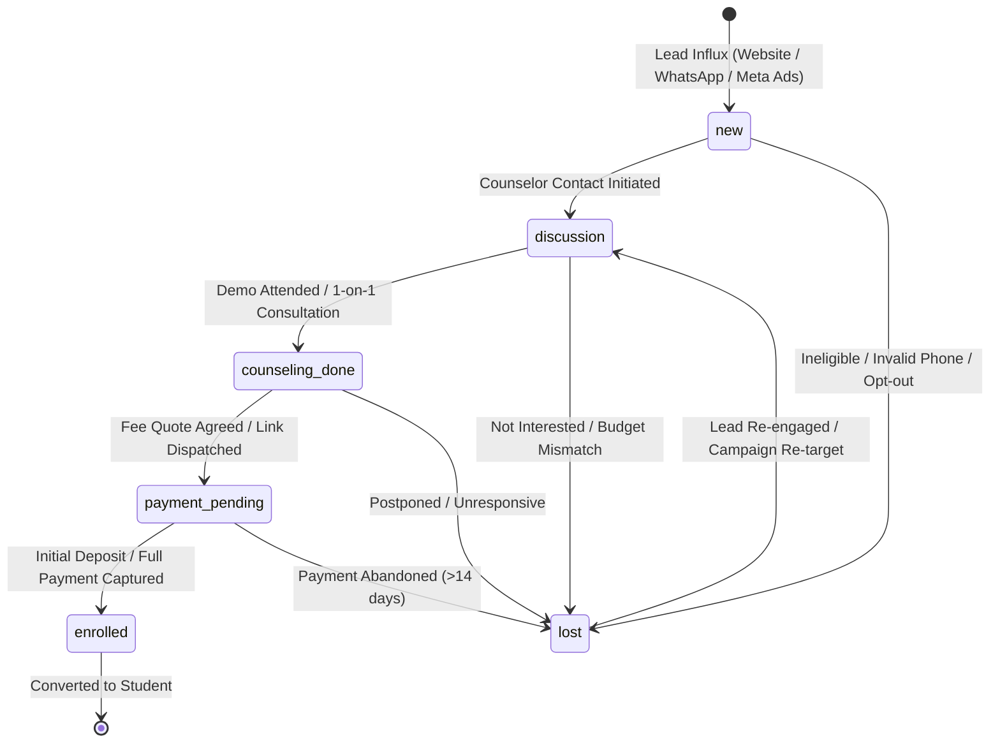
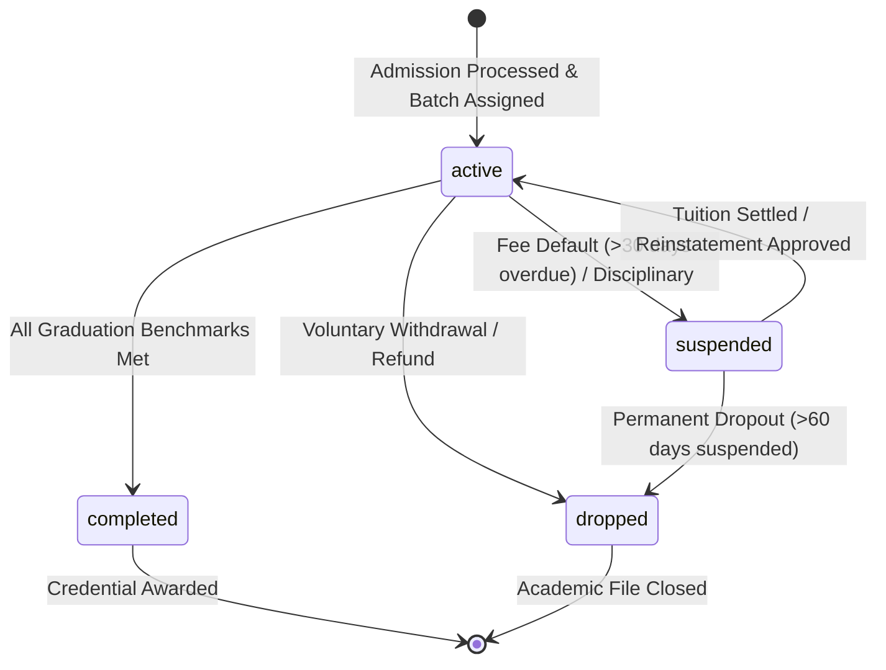
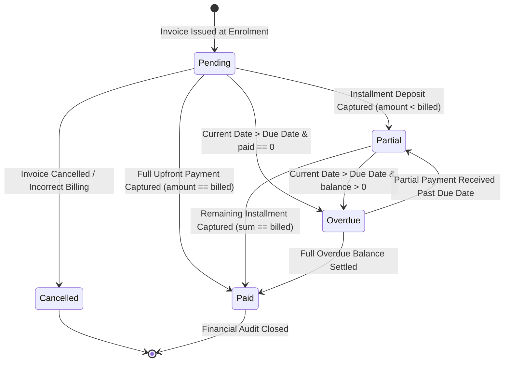
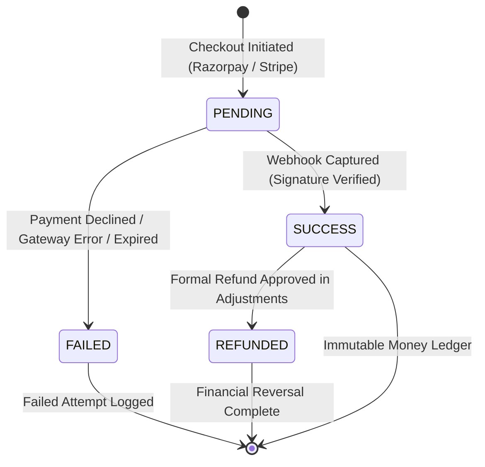
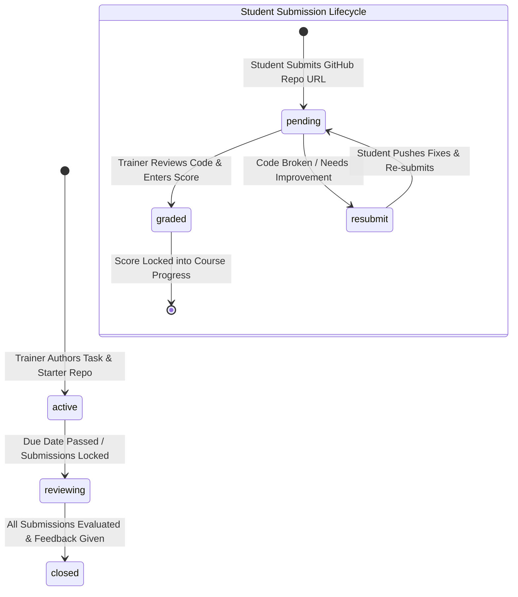
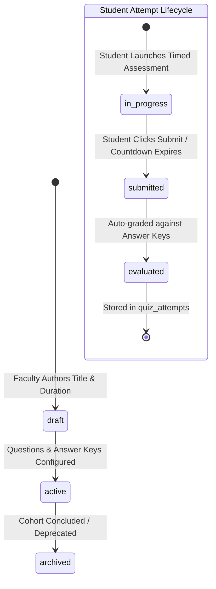
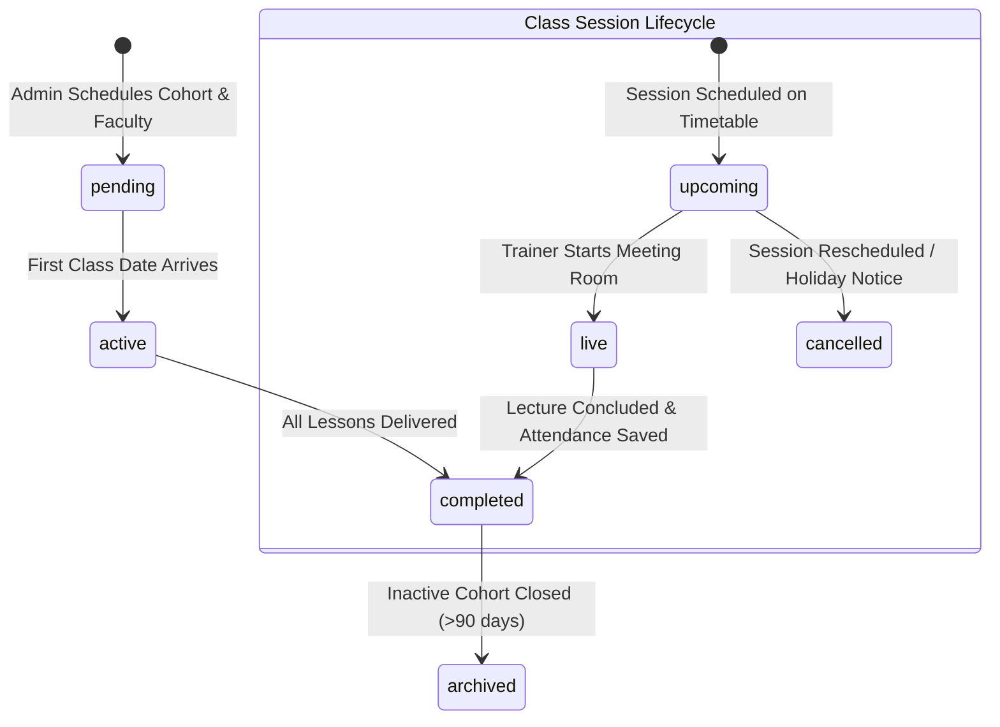

# Status State Machines & Transition Rules
**Project:** Shared Multi-Brand LMS & Admissions CRM (`TeluguAI.com` & `GenAI99.com`)  
**Scope:** Formal State Machines, Allowed Transitions, Guard Conditions, and Database Side Effects  
**Target Engine:** PostgreSQL 16+  
**Document Code:** `/database/08_status_state_machines.md`

---

## 1. CRM Leads State Machine

### Transition Specifications: `leads.funnel_stage`

| Current State | Next State | Allowed Actor(s) | Guard Conditions & Pre-requisites | Automated Database Side Effects |
|---|---|---|---|---|
| `[*]` | `new` | System / Webhook / Counselor | Valid phone (E.164) and brand ID | Inserts row into `leads` and `lead_stage_history`. Dispatches `lead_welcome` WhatsApp template. |
| `new` | `discussion` | Counselor | First call attempted; notes logged in `lead_notes` | Appends entry to `lead_stage_history`. |
| `discussion` | `counseling_done` | Counselor | Consultation notes completed; batch timing agreed | Updates `lead_stage_history`. |
| `counseling_done` | `payment_pending` | Counselor | `fee_quoted` is set; invoice draft generated | Updates `lead_stage_history`. Sends WhatsApp payment checkout link. |
| `payment_pending` | `enrolled` | Counselor / System Webhook | Payment received in `payments` matching initial deposit | Updates `leads(converted_student_id)`. Inserts student, enrolment, invoice, and welcome WhatsApp kit. |
| *Any Stage* | `lost` | Counselor / Admin | Reason recorded in `lead_notes` | Updates `lead_stage_history(transition_notes)`. Cancels open follow-up tasks. |
| `lost` | `discussion` | Counselor / Marketing | New inquiry inbound or manual revival | Inserts new `lead_stage_history` entry; reassigns to active counselor queue. |

---

## 2. Student Enrolment State Machine

### Transition Specifications: `enrolments.status`

| Current State | Next State | Allowed Actor(s) | Guard Conditions & Pre-requisites | Automated Database Side Effects |
|---|---|---|---|---|
| `[*]` | `active` | Counselor / Admin | Student profile exists; valid `batch_id` with available capacity | Inserts into `enrolment_status_history`. Creates initial record in `course_progress`. |
| `active` | `completed` | Admin / Automated Job | Benchmark verified: `attendance >= 80%`, `assignments >= 80%`, `quiz_avg >= 75%`, `balance_due = 0` | Inserts into `enrolment_status_history`. Unlocks certificate generation. |
| `active` | `suspended` | Admin / System Rule | Outstanding fee balance > 30 days overdue | Disables live lecture room join links; logs suspension reason in `enrolment_status_history`. |
| `suspended` | `active` | Admin | Overdue invoice cleared (`status = 'Paid'`) | Re-enables LMS and lecture room access; logs reinstatement in `enrolment_status_history`. |
| `active` / `suspended` | `dropped` | Admin | Formal withdrawal request signed; refund/adjustment processed | Releases batch occupancy count; updates `enrolment_status_history`. |

---

## 3. Invoices & Billing State Machine

### Transition Specifications: `invoices.status`

| Current State | Next State | Allowed Actor(s) | Guard Conditions & Pre-requisites | Automated Database Side Effects |
|---|---|---|---|---|
| `[*]` | `Pending` | Admin / Counselor | Valid `enrolment_id`, `billed_amount > 0`, `due_date >= CURRENT_DATE` | Generates per-brand sequence `invoice_number`. |
| `Pending` | `Partial` | System / Admin | `0 < paid_amount < billed_amount` | Updates `balance_due`. Generates `payments` receipt row. |
| `Pending` / `Partial` | `Paid` | System / Admin | `paid_amount == billed_amount` (`balance_due == 0`) | Updates `course_progress(tuition_paid_in_full = true)`. Dispatches `fee_receipt` WhatsApp template. |
| `Pending` / `Partial` | `Overdue` | Automated Daily Cron | `CURRENT_DATE > due_date` and `balance_due > 0` | Triggers daily counselor payment alert queue. Sends WhatsApp payment reminder. |
| `Overdue` | `Paid` | System / Admin | Full remaining balance cleared | Removes overdue penalty flag; restores student portal privileges. |
| `Pending` | `Cancelled` | Super Admin / Admin | No payments recorded against invoice | Reverses billed claim; logs justification in `audit_logs`. |

---

## 4. Payments & Gateway Transactions State Machine

### Transition Specifications: `payments.status`

| Current State | Next State | Triggering Mechanism | Guard Conditions & Pre-requisites | Automated Database Side Effects |
|---|---|---|---|---|
| `[*] ` | `PENDING` | Student Portal Checkout | Active invoice with `balance_due > 0` | Inserts `payment_transactions` row with gateway order ID. |
| `PENDING` | `SUCCESS` | Gateway Webhook (`payment.captured`) | Idempotent webhook verification (`idempotency_key` unique) | Inserts immutable `payments` row. Deducts `balance_due` from `invoices`. Generates tax receipt `REC-TAI-2026-xxx`. |
| `PENDING` | `FAILED` | Gateway Webhook / Timeout | Gateway error callback | Marks `payment_transactions.status = 'FAILED'`. Leaves invoice balance intact. |
| `SUCCESS` | `REFUNDED` | Super Admin Approval | Signed adjustment in `payment_adjustments` | Marks `payment_transactions.status = 'REFUNDED'`. Re-opens invoice balance. |

---

## 5. Homework Assignments & Code Grading State Machine

### Transition Specifications: `assignments.status` & `assignment_submissions.status`

| Entity | Current State | Next State | Allowed Actor | Guard Conditions | Automated Database Side Effects |
|---|---|---|---|---|---|
| `assignments` | `active` | `reviewing` | Trainer / System | Due date elapsed; student submissions queued | Locks submission portal for non-extended students. |
| `assignments` | `reviewing` | `closed` | Trainer | All pending submissions graded | Updates batch assignment completion rate in `course_progress`. |
| `submissions` | `[*] ` | `pending` | Student | Valid GitHub repository URL submitted | Inserts `assignment_submissions` row; alerts trainer grading queue. |
| `submissions` | `pending` | `graded` | Trainer | `score BETWEEN 0 AND max_score`, written feedback provided | Recalculates `course_progress(assignments_done)`. |
| `submissions` | `pending` | `resubmit` | Trainer | Specific qualitative feedback on what to correct | Dispatches WhatsApp/Dashboard notice to student requesting code fixes. |
| `submissions` | `resubmit` | `pending` | Student | Updated repo committed; student re-clicks submit | Re-enqueues submission in trainer's pending review list. |

---

## 6. Multiple-Choice Quizzes State Machine

### Transition Specifications: `quizzes.status` & `quiz_attempts`

| Entity | Current State | Next State | Allowed Actor | Guard Conditions | Automated Database Side Effects |
|---|---|---|---|---|---|
| `quizzes` | `draft` | `active` | Trainer / Admin | Minimum 1 question defined with valid correct option | Quiz becomes visible in student test arena. |
| `quizzes` | `active` | `archived` | Trainer / Admin | No active cohorts taking exam | Hides quiz from student arena; preserves historical attempts. |
| `attempts` | `in_progress`| `submitted` | Student / Timer | Countdown timer reaches 0 or student clicks submit | Freezes selected option indices in `quiz_attempt_answers`. |
| `attempts` | `submitted` | `evaluated` | PostgreSQL Engine | Instant comparison with `quiz_questions.correct_option_index` | Computes `score_percent` and `is_passed`. Updates `course_progress(quiz_average)`. |

---

## 7. Academic Cohorts & Class Delivery State Machine

### Transition Specifications: `batches.status` & `class_sessions.status`

| Entity | Current State | Next State | Allowed Actor | Guard Conditions | Automated Database Side Effects |
|---|---|---|---|---|---|
| `batches` | `pending` | `active` | Admin / System | Batch reaches `start_date` and trainer is confirmed | Activates batch schedule on student calendar. |
| `batches` | `active` | `completed` | Admin | Final syllabus lesson and capstone concluded | Computes final cohort graduation eligibility. |
| `sessions` | `upcoming` | `live` | Trainer | Scheduled lecture window open | Flags live session banner on student dashboard. |
| `sessions` | `live` | `completed` | Trainer | Lecture ended; attendance marked and saved | Enables video replay and lecture notes upload inputs. |
| `sessions` | `upcoming` | `cancelled` | Admin / Trainer | Holiday / faculty emergency notice posted | Frees trainer exclusion slot; dispatches class reschedule alert. |
