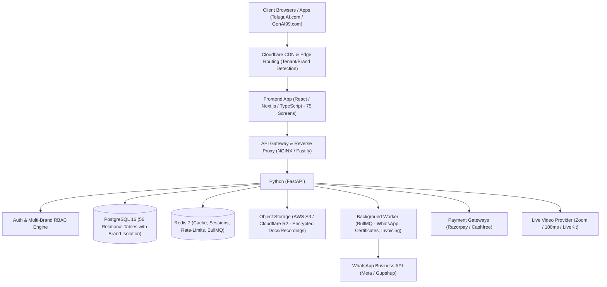
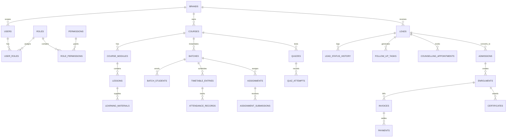

# TeluguAI.com & GenAI99.com — LMS & Admissions CRM
## End-to-End System Architecture & Technical Blueprint

---

### 1. Executive Architecture Summary

The platform is an enterprise-grade **Learning Management System (LMS)** integrated with an **Admissions Customer Relationship Management (CRM)** engine. It powers two distinct educational brands:
1. **TeluguAI.com** (Focus on regional vernacular AI education)
2. **GenAI99.com** (Focus on professional Generative AI certifications and bootcamps)

Both brands operate on a **unified, multi-tenant core** with brand-isolated data, custom white-labeled themes, brand-specific communication templates (WhatsApp/Email), and role-based portals.



---

### 2. Multi-Brand Multi-Tenancy Strategy

To ensure zero data leaks between **TeluguAI.com** and **GenAI99.com** while maintaining shared operations:
1. **Brand Resolution**: Requests determine active brand via:
   - Host header (`teluguai.com` vs `genai99.com`)
   - Explicit tenant header (`X-Brand-Id: teluguai | genai99`) for mobile/API clients
   - Brand switcher in Super Admin console
2. **Database Scoping**:
   - Every tenant-scoped table has a mandatory `brand_id UUID REFERENCES brands(id)`.
   - PostgreSQL **Row Level Security (RLS)** or Prisma/Kysely middleware automatically injects `WHERE brand_id = current_setting('app.current_brand_id')` on queries.
3. **Dynamic Theme Engine**:
   - Dynamic CSS variable injection (`--brand-primary`, `--brand-secondary`, `--brand-logo`, etc.) loaded at runtime based on the resolved brand context.

---

### 3. High-Level Technology Stack Recommendation

| Layer | Recommended Technology | Justification |
| :--- | :--- | :--- |
| **Frontend Framework** | **React 19 / Vite or Next.js 15 (TypeScript)** | Ultra-fast SPA navigation for dashboards, strong type safety, modular screen boundaries. |
| **Styling & UI** | **Vanilla CSS Modules + Design Token System** | Maximum flexibility, zero bloat, high-performance animations, fluid responsive layouts. |
| **Client State Management** | **Zustand + TanStack Query (React Query v5)** | Zustand for client UI state (brand switcher, user session, sidebar); TanStack Query for caching 75+ screen API responses. |
| **Backend Framework** | **Node.js + NestJS (or Fastify + Express TypeScript)** | Enterprise modular architecture with Dependency Injection, strong DTO validation, and automated OpenAPI/Swagger specs. |
| **ORM & Migrations** | **Prisma ORM or Drizzle ORM + PostgreSQL 16** | Strict type-safety matching the 56-table relational schema; reproducible migrations. |
| **In-Memory Store & Queue** | **Redis 7 + BullMQ** | Asynchronous jobs (PDF invoices, WhatsApp dispatch, certificate rendering, attendance analytics). |
| **Object Storage** | **Cloudflare R2 / AWS S3 + Pre-signed URLs** | Secure storage for student IDs, assignment uploads, course resources, and video recordings. |
| **Authentication** | **JWT with HttpOnly Secure Cookies + Refresh Token Rotation** | Granular RBAC (Super Admin, Admin, Counselor, Trainer, Student) with multi-brand tenancy context. |

---

### 4. Database Architecture (56 Relational Tables Grouped by Domain)



#### Detailed Entity Domains:
1. **Platform & Tenancy (10 Tables)**: `brands`, `users`, `roles`, `permissions`, `user_roles`, `role_permissions`, `user_brand_access`, `user_sessions`, `audit_logs`, `system_notifications`
2. **Course & Curriculum (7 Tables)**: `course_categories`, `courses`, `course_prerequisites`, `course_modules`, `lessons`, `learning_materials`, `course_resources`
3. **Batches & Scheduling (6 Tables)**: `batches`, `batch_students`, `trainer_assignments`, `class_sessions`, `timetable_entries`, `attendance_records`
4. **Student & Admissions (5 Tables)**: `student_profiles`, `admissions`, `enrolments`, `enrolment_status_history`, `student_documents`
5. **Counselor & CRM (7 Tables)**: `lead_sources`, `leads`, `lead_status_history`, `lead_assignments`, `follow_up_tasks`, `counselling_appointments`, `communication_logs`
6. **Finance & Billing (7 Tables)**: `fee_plans`, `fee_installments`, `invoices`, `invoice_items`, `payments`, `payment_transactions`, `refunds_adjustments`
7. **Assessment & Grading (10 Tables)**: `assignments`, `assignment_attachments`, `assignment_submissions`, `submission_reviews`, `quizzes`, `quiz_questions`, `quiz_options`, `quiz_attempts`, `quiz_answers`, `grades_feedback`
8. **Live Classes & Media (4 Tables)**: `live_classes`, `live_class_attendance`, `class_recordings`, `media_assets`
9. **Engagement & Support (6 Tables)**: `lesson_progress`, `course_progress`, `certificate_templates`, `certificates`, `announcements`, `announcement_reads`
10. **Helpdesk & Integrations (6 Tables)**: `support_tickets`, `support_conversations`, `support_messages`, `system_settings`, `integration_settings`, `webhook_events`

---

### 5. Backend Monolith/Modular Architecture

The backend follows **Clean Domain-Driven Architecture** organized into isolated, reusable feature modules:

```text
backend/
├── src/
│   ├── app.module.ts                   # Root application dependency graph
│   ├── main.ts                         # Server entry point & Swagger docs bootstrap
│   │
│   ├── config/                         # Environment & application configs
│   │   ├── app.config.ts
│   │   ├── database.config.ts
│   │   ├── auth.config.ts
│   │   ├── redis.config.ts
│   │   └── storage.config.ts
│   │
│   ├── common/                         # Shared kernel utilities & infrastructure
│   │   ├── constants/
│   │   ├── decorators/                 # @CurrentBrand(), @CurrentUser(), @Roles()
│   │   ├── filters/                    # GlobalExceptionFilter, RLSExceptionFilter
│   │   ├── guards/                     # JwtAuthGuard, BrandTenantGuard, RbacGuard
│   │   ├── interceptors/               # ResponseTransformInterceptor, AuditLogInterceptor
│   │   ├── middleware/                 # BrandResolverMiddleware, RequestLoggerMiddleware
│   │   └── utils/                      # Date, pagination, crypto, hashing helpers
│   │
│   ├── database/                       # Database migrations & seeds
│   │   ├── prisma/
│   │   │   ├── schema.prisma           # 56 PostgreSQL relational models
│   │   │   ├── migrations/             # Timestamped SQL migration files
│   │   │   └── seed.ts                 # Default roles, super admin, brand seed data
│   │   └── redis/                      # Redis client factory & cache manager
│   │
│   ├── modules/                        # Domain Feature Modules (Controllers, Services, DTOs)
│   │   ├── auth/                       # Login, register, MFA, refresh tokens, password reset
│   │   ├── brands/                     # Tenant/brand management & configuration
│   │   ├── users/                      # User lifecycle, profiles, role mapping
│   │   ├── rbac/                       # Roles, permissions, access matrices
│   │   ├── courses/                    # Courses, categories, modules, lessons
│   │   ├── batches/                    # Batches, batch students, trainer assignments
│   │   ├── timetable/                  # Class schedules, timetable slots, conflict engine
│   │   ├── attendance/                 # Daily roll call, QR attendance, attendance analytics
│   │   ├── leads-crm/                  # Leads, pipeline, follow-ups, counselling calendar
│   │   ├── admissions/                 # Enrolment workflow, student dossier, document KYC
│   │   ├── finance/                    # Fee plans, invoices, payments, refunds, Razorpay
│   │   ├── assignments/                # Assignment creation, student submissions, rubric grading
│   │   ├── quizzes/                    # Question banks, timed quiz engine, evaluation
│   │   ├── live-classes/               # Zoom/LiveKit integration, room launcher, attendance sync
│   │   ├── recordings/                 # Video archive, transcoded video streaming URLs
│   │   ├── certificates/               # PDF certificate generation engine, verification portal
│   │   ├── announcements/              # Push/in-app notices, read tracking
│   │   ├── support/                    # Ticket system, live agent chat, inquiry routing
│   │   ├── integrations/               # WhatsApp Cloud API, Email (SendGrid/SES), Webhooks
│   │   └── analytics-reports/          # Executive KPI dashboards, conversion reports, export jobs
│   │
│   ├── workers/                        # BullMQ Async Queue Processors
│   │   ├── whatsapp.worker.ts          # Asynchronous WhatsApp messaging queue
│   │   ├── email.worker.ts             # Bulk transactional email delivery
│   │   ├── certificate.worker.ts       # Canvas/Puppeteer PDF certificate generator
│   │   └── invoice.worker.ts           # Automated recurring invoice generation
│   │
│   └── storage/                        # Object storage service (S3/R2 presigned upload/download)
│       └── storage.service.ts
│
├── test/                               # E2E & Unit Test suites
├── Dockerfile                          # Production container configuration
├── docker-compose.yml                  # Postgres, Redis, LocalStack development environment
└── package.json
```

---

### 6. Frontend Architecture & Modular Screen Folder Structure

The frontend is architected as a **Feature-Driven Design (FDD)** layout. Every portal has a clean namespace, and **every major screen (all 75 screens)** has its own dedicated directory containing:
- `[ScreenName]View.tsx`: Main screen container & view component
- `[ScreenName].styles.css`: Scoped Vanilla CSS styles with brand tokens
- `use[ScreenName].ts`: Screen-specific state, mutations, and query hooks
- `[ScreenName].types.ts`: Local view models and contract types
- `components/`: Sub-components specific exclusively to this screen

```text
frontend/
├── public/
│   ├── assets/
│   │   ├── brands/
│   │   │   ├── teluguai/               # TeluguAI logos, banners, watermarks
│   │   │   └── genai99/                # GenAI99 logos, banners, badges
│   │   └── icons/
│   └── favicon.ico
│
├── src/
│   ├── app/                            # Root routing, Providers & Layouts
│   │   ├── App.tsx                     # Top-level Router & Brand Provider
│   │   ├── main.tsx                    # React mount point
│   │   └── index.css                   # Global CSS reset, typography, Brand CSS variables
│   │
│   ├── assets/                         # Static images and SVGs
│   ├── config/                         # API base URLs, brand presets, feature flags
│   ├── core/                           # Foundation tokens & infrastructure
│   │   ├── api/                        # Axios instance, interceptors, error handler
│   │   ├── auth/                       # Auth tokens, session context, route guards
│   │   ├── theme/                      # Multi-brand theme provider, CSS variable injector
│   │   └── i18n/                       # English & Telugu localization dictionaries
│   │
│   ├── shared/                         # Reusable cross-portal UI primitives
│   │   ├── components/                 # Button, Input, Modal, Table, Badge, Dropdown, Tabs
│   │   ├── hooks/                      # useDebounce, useMediaQuery, useNotification
│   │   └── utils/                      # formatCurrency, formatDate, validatePhone
│   │
│   └── screens/                        # 75 SCREENS ORGANIZED BY DOMAIN
│       │
│       ├── super-admin/                # SUPER ADMIN PORTAL (SA-01 to SA-08)
│       │   ├── SA01-PlatformDashboard/
│       │   │   ├── PlatformDashboardView.tsx
│       │   │   ├── PlatformDashboard.styles.css
│       │   │   ├── usePlatformDashboard.ts
│       │   │   ├── PlatformDashboard.types.ts
│       │   │   └── components/         # BrandMetricsCard, RevenueSplitChart, SystemHealthWidget
│       │   ├── SA02-BrandManagement/
│       │   │   ├── BrandManagementView.tsx
│       │   │   ├── BrandManagement.styles.css
│       │   │   ├── useBrandManagement.ts
│       │   │   └── components/         # BrandEditorModal, DomainConfigCard, BrandLogoUploader
│       │   ├── SA03-PlatformUserManagement/
│       │   │   ├── PlatformUserManagementView.tsx
│       │   │   ├── usePlatformUsers.ts
│       │   │   └── components/         # UserTable, BrandAccessPicker, InviteUserModal
│       │   ├── SA04-RolePermissionManagement/
│       │   │   ├── RolePermissionManagementView.tsx
│       │   │   └── components/         # PermissionMatrixGrid, CustomRoleDrawer
│       │   ├── SA05-WhatsAppIntegration/
│       │   │   ├── WhatsAppIntegrationView.tsx
│       │   │   └── components/         # MetaApiConfigCard, TemplateReviewer, WebhookLogTable
│       │   ├── SA06-PlatformAdminSettings/
│       │   │   ├── PlatformAdminSettingsView.tsx
│       │   │   └── components/         # SMTPConfigSection, StorageBucketForm, FeatureToggles
│       │   ├── SA07-SuperAdminLogin/
│       │   │   ├── SuperAdminLoginView.tsx
│       │   │   └── components/         # MfaChallengeModal, SecuredLoginForm
│       │   └── SA08-SystemAuditOversight/
│       │       ├── SystemAuditOversightView.tsx
│       │       └── components/         # AuditLogTable, LogInspectorModal, IPFilterBar
│       │
│       ├── admin/                      # ADMIN PORTAL (AD-01 to AD-16)
│       │   ├── AD01-AdminDashboard/
│       │   │   ├── AdminDashboardView.tsx
│       │   │   └── components/         # QuickStatsCards, BatchStatusWidget, RevenueSummaryCard
│       │   ├── AD02-UserManagement/
│       │   │   ├── AdminUserManagementView.tsx
│       │   │   └── components/         # StaffFilterToolbar, StaffProfileCard, CreateStaffModal
│       │   ├── AD03-CourseCatalogue/
│       │   │   ├── CourseCatalogueView.tsx
│       │   │   └── components/         # CourseCardGrid, CategoryFilter, CourseStatusBadge
│       │   ├── AD04-CourseCreationWizard/
│       │   │   ├── CourseCreationWizardView.tsx
│       │   │   └── components/         # GeneralInfoStep, PricingTierStep, MediaUploaderStep
│       │   ├── AD05-CurriculumBuilder/
│       │   │   ├── CurriculumBuilderView.tsx
│       │   │   └── components/         # DragDropModuleList, LessonItemEditor, ResourcePicker
│       │   ├── AD06-BatchManagement/
│       │   │   ├── BatchManagementView.tsx
│       │   │   └── components/         # ActiveBatchesTable, BatchCapacityBar, BatchFilterBar
│       │   ├── AD07-CreateNewBatch/
│       │   │   ├── CreateNewBatchView.tsx
│       │   │   └── components/         # BatchScheduleForm, TrainerAssignDropdown, CapacityInput
│       │   ├── AD08-TimetableSchedule/
│       │   │   ├── TimetableScheduleView.tsx
│       │   │   └── components/         # WeeklyCalendarGrid, ConflictWarningBanner, SlotEditorModal
│       │   ├── AD09-StudentManagement/
│       │   │   ├── StudentManagementView.tsx
│       │   │   └── components/         # StudentRosterTable, BatchFilter, QuickActionMenu
│       │   ├── AD10-StudentProfileDossier/
│       │   │   ├── StudentProfileDossierView.tsx
│       │   │   └── components/         # AcademicTimeline, AttendanceSummary, FeeInstallmentCard
│       │   ├── AD11-AttendanceOverview/
│       │   │   ├── AttendanceOverviewView.tsx
│       │   │   └── components/         # HeatmapCalendar, LowAttendanceAlertTable, ExportReportBtn
│       │   ├── AD12-FeeManagement/
│       │   │   ├── FeeManagementView.tsx
│       │   │   └── components/         # DuesSummaryCards, PlanBuilderModal, CollectionProgress
│       │   ├── AD13-InvoiceManagement/
│       │   │   ├── InvoiceManagementView.tsx
│       │   │   └── components/         # InvoiceTable, InvoicePreviewModal, ReceiptGeneratorBtn
│       │   ├── AD14-AnnouncementsManager/
│       │   │   ├── AnnouncementsManagerView.tsx
│       │   │   └── components/         # AnnouncementComposer, AudienceTargetSelector, NoticeHistory
│       │   ├── AD15-ReportsAnalytics/
│       │   │   ├── ReportsAnalyticsView.tsx
│       │   │   └── components/         # EnrolmentTrendChart, TrainerRatingGraph, ExportCsvModal
│       │   └── AD16-WorkflowApprovalQueue/
│       │       ├── WorkflowApprovalQueueView.tsx
│       │       └── components/         # RefundRequestCards, BatchTransferModal, ApprovalTimeline
│       │
│       ├── counselor-crm/              # COUNSELOR / ADMISSIONS CRM (CO-01 to CO-12)
│       │   ├── CO01-CounselorLogin/
│       │   │   ├── CounselorLoginView.tsx
│       │   │   └── components/         # BrandBrandedLoginForm, ShiftCheckinModal
│       │   ├── CO02-CounselorDashboard/
│       │   │   ├── CounselorDashboardView.tsx
│       │   │   └── components/         # DailyCallsTargetWidget, TodayFollowUpsList, ConversionRateGauge
│       │   ├── CO03-LeadPipelineKanban/
│       │   │   ├── LeadPipelineKanbanView.tsx
│       │   │   └── components/         # KanbanBoard, KanbanColumn, DragLeadCard, QuickMoveMenu
│       │   ├── CO04-LeadManagement/
│       │   │   ├── LeadManagementView.tsx
│       │   │   └── components/         # LeadFilterDrawer, BulkAssignModal, LeadSourceBadges
│       │   ├── CO05-LeadProfileTimeline/
│       │   │   ├── LeadProfileTimelineView.tsx
│       │   │   └── components/         # CallLogHistory, WhatsAppChatPreview, NoteEditor, DispositionPicker
│       │   ├── CO06-FollowUpTaskManager/
│       │   │   ├── FollowUpTaskManagerView.tsx
│       │   │   └── components/         # OverdueTasksAlert, TaskCalendarStrip, CompleteTaskModal
│       │   ├── CO07-CounsellingCalendar/
│       │   │   ├── CounsellingCalendarView.tsx
│       │   │   └── components/         # SlotBookingModal, GoogleMeetLinkBadge, AppointmentCard
│       │   ├── CO08-CounselorCourseCatalogue/
│       │   │   ├── CounselorCourseCatalogueView.tsx
│       │   │   └── components/         # FeeCalculatorWidget, CurriculumBrochureDownload, DiscountCodeInput
│       │   ├── CO09-StudentEnrolmentWizard/
│       │   │   ├── StudentEnrolmentWizardView.tsx
│       │   │   └── components/         # LeadToAdmissionForm, PaymentOptionSelector, WelcomeEmailPreview
│       │   ├── CO10-PaymentStatusTracking/
│       │   │   ├── PaymentStatusTrackingView.tsx
│       │   │   └── components/         # TransactionVerificationCard, ScreenshotProofViewer
│       │   ├── CO11-CounselorPerformance/
│       │   │   ├── CounselorPerformanceView.tsx
│       │   │   └── components/         # LeaderboardTable, RevenueGeneratedCard, CallDurationMetrics
│       │   └── CO12-CommunicationHistory/
│       │       ├── CommunicationHistoryView.tsx
│       │       └── components/         # FullCallRecordingsList, WhatsAppMessageThread, EmailLogView
│       │
│       ├── trainer/                    # TRAINER / FACULTY PORTAL (TR-01 to TR-15)
│       │   ├── TR01-TrainerLogin/
│       │   │   ├── TrainerLoginView.tsx
│       │   │   └── components/         # TrainerAuthCard
│       │   ├── TR02-TrainerDashboard/
│       │   │   ├── TrainerDashboardView.tsx
│       │   │   └── components/         # NextUpcomingClassBanner, PendingGradingCounter, ActiveBatchesSlider
│       │   ├── TR03-TrainerCourseDashboard/
│       │   │   ├── TrainerCourseDashboardView.tsx
│       │   │   └── components/         # AssignedCoursesList, SyllabusCompletionMeter
│       │   ├── TR04-TrainerBatchDashboard/
│       │   │   ├── TrainerBatchDashboardView.tsx
│       │   │   └── components/         # BatchRosterGrid, StudentQuickInspectModal
│       │   ├── TR05-TrainerTimetable/
│       │   │   ├── TrainerTimetableView.tsx
│       │   │   └── components/         # DailyScheduleView, RescheduleRequestModal
│       │   ├── TR06-StudentProgressOverview/
│       │   │   ├── StudentProgressOverviewView.tsx
│       │   │   └── components/         # CohortPerformanceMatrix, AtRiskLearnersAlert
│       │   ├── TR07-AttendanceManagement/
│       │   │   ├── AttendanceManagementView.tsx
│       │   │   └── components/         # RollCallToggleTable, BatchAttendanceLockBtn, AttendanceStats
│       │   ├── TR08-LearningMaterialManager/
│       │   │   ├── LearningMaterialManagerView.tsx
│       │   │   └── components/         # FileUploaderDropzone, MaterialTypeSelector, ShareWithBatchModal
│       │   ├── TR09-LiveClassManager/
│       │   │   ├── LiveClassManagerView.tsx
│       │   │   └── components/         # LaunchZoomBtn, MeetingConfigCard, LiveClassStatusIndicator
│       │   ├── TR10-AssignmentManager/
│       │   │   ├── AssignmentManagerView.tsx
│       │   │   └── components/         # AssignmentCreatorModal, RubricBuilder, DueDatePicker
│       │   ├── TR11-QuizTestBuilder/
│       │   │   ├── QuizTestBuilderView.tsx
│       │   │   └── components/         # QuestionEditorItem, MultipleChoiceOptions, TimerConfig
│       │   ├── TR12-StudentSubmissions/
│       │   │   ├── StudentSubmissionsView.tsx
│       │   │   └── components/         # SubmissionTable, PlagiarismScoreBadge, CodeViewerDrawer
│       │   ├── TR13-GradingFeedback/
│       │   │   ├── GradingFeedbackView.tsx
│       │   │   └── components/         # RubricGradingSlider, AudioFeedbackRecorder, FeedbackTextEditor
│       │   ├── TR14-StudentProgressReports/
│       │   │   ├── StudentProgressReportsView.tsx
│       │   │   └── components/         # BatchProgressSummary, IndividualReportCardGenerator
│       │   └── TR15-CourseCompletionReview/
│       │       ├── CourseCompletionReviewView.tsx
│       │       └── components/         # EligibleStudentTable, BatchSignOffBtn, CertificatePreview
│       │
│       ├── student/                    # STUDENT LEARNING PORTAL (ST-01 to ST-18)
│       │   ├── ST01-StudentAuth/
│       │   │   ├── StudentAuthView.tsx
│       │   │   └── components/         # OtpVerificationForm, PasswordResetModal
│       │   ├── ST02-StudentLearningDashboard/
│       │   │   ├── StudentLearningDashboardView.tsx
│       │   │   └── components/         # ContinueLearningCard, LiveClassCountdown, MilestoneTracker
│       │   ├── ST03-StudentCourseDashboard/
│       │   │   ├── StudentCourseDashboardView.tsx
│       │   │   └── components/         # CourseOverviewBanner, ModuleAccordionTree, ProgressCircle
│       │   ├── ST04-LessonContentView/
│       │   │   ├── LessonContentView.tsx
│       │   │   └── components/         # VideoPlayerWithNotes, MarkdownReader, MarkAsCompleteBtn
│       │   ├── ST05-LiveClassRoom/
│       │   │   ├── LiveClassRoomView.tsx
│       │   │   └── components/         # EmbeddedMeetingIframe, LiveChatSidebar, ResourceLinks
│       │   ├── ST06-RecordedClassesArchive/
│       │   │   ├── RecordedClassesArchiveView.tsx
│       │   │   └── components/         # ClassVideoCard, SearchByDateFilter, DownloadNotesBtn
│       │   ├── ST07-StudentAssignments/
│       │   │   ├── StudentAssignmentsView.tsx
│       │   │   └── components/         # SubmissionUploadModal, AssignmentDeadlineBadge, GradeReviewModal
│       │   ├── ST08-QuizzesTestsHub/
│       │   │   ├── QuizzesTestsHubView.tsx
│       │   │   └── components/         # AvailableQuizzesList, PreviousScoresCard
│       │   ├── ST09-QuizTakingEngine/
│       │   │   ├── QuizTakingEngineView.tsx
│       │   │   └── components/         # TimedQuestionContainer, QuestionPaletteNavigator, SubmitConfirmModal
│       │   ├── ST10-QuizResultsBreakdown/
│       │   │   ├── QuizResultsBreakdownView.tsx
│       │   │   └── components/         # ScoreSummaryCard, AnswerExplanationAccordion, RetakeQuizBtn
│       │   ├── ST11-LearningMaterialsHub/
│       │   │   ├── LearningMaterialsHubView.tsx
│       │   │   └── components/         # ResourceSearchBox, DownloadFileCard, MaterialTagFilter
│       │   ├── ST12-MyLearningProgress/
│       │   │   ├── MyLearningProgressView.tsx
│       │   │   └── components/         # AttendancePercentageMeter, CompletedLessonsGraph, SkillRadar
│       │   ├── ST13-FeesAndPayments/
│       │   │   ├── FeesAndPaymentsView.tsx
│       │   │   └── components/         # PaymentPlanCard, PayNowButton, DownloadInvoicePdfBtn
│       │   ├── ST14-CertificatesCredentials/
│       │   │   ├── CertificatesCredentialsView.tsx
│       │   │   └── components/         # CertificateViewerCard, LinkedInShareBtn, DownloadPdfModal
│       │   ├── ST15-StudentAnnouncements/
│       │   │   ├── StudentAnnouncementsView.tsx
│       │   │   └── components/         # AnnouncementCard, ImportantNoticeBadge
│       │   ├── ST16-SupportMessages/
│       │   │   ├── SupportMessagesView.tsx
│       │   │   └── components/         # MentorChatBox, MessageThreadList, AttachmentUpload
│       │   ├── ST17-StudentProfileSettings/
│       │   │   ├── StudentProfileSettingsView.tsx
│       │   │   └── components/         # ProfileAvatarUploader, EmergencyContactForm, PasswordChangeForm
│       │   └── ST18-HelpSupportCenter/
│       │       ├── HelpSupportCenterView.tsx
│       │       └── components/         # FaqAccordion, CreateTicketModal, ContactHelplineCard
│       │
│       └── shared-utilities/           # SHARED SCREENS & MODALS (SH-01 to SH-06)
│           ├── SH01-SharedLoginSession/
│           │   ├── SharedLoginSessionView.tsx
│           │   └── components/         # SessionTimeoutModal, BrandAutoRedirect
│           ├── SH02-NotificationCenter/
│           │   ├── NotificationCenterView.tsx
│           │   └── components/         # NotificationDropdown, MarkAllReadBtn, NotificationFilter
│           ├── SH03-GlobalOmnisearch/
│           │   ├── GlobalOmnisearchModal.tsx
│           │   └── components/         # OmnisearchInput, QuickResultCategoryList
│           ├── SH04-DocumentFileUploader/
│           │   ├── DocumentFileUploaderModal.tsx
│           │   └── components/         # ChunkedUploadProgressBar, FileValidationWarning
│           ├── SH05-AuditActivityHistory/
│           │   ├── AuditActivityHistoryView.tsx
│           │   └── components/         # EventLogTimeline, JsonDiffViewer
│           └── SH06-SystemErrorEmptyStates/
│               ├── NotFound404View.tsx
│               ├── AccessDenied403View.tsx
│               └── EmptyStateCard.tsx
```

---

### 7. Core End-to-End Workflows & Inter-Module Communication

1. **Admissions & Lead-to-Enrolment Flow**:
   ```mermaid
   sequenceDiagram
       participant L as Lead / Website
       participant C as Counselor (CO-03/04)
       participant CRM as CRM Module
       participant Pay as Razorpay Gateway
       participant AD as Admin / Admissions
       participant S as Student Account (ST-01)
       participant WA as WhatsApp Worker

       L->>CRM: Web Inquiry captured (TeluguAI or GenAI99)
       CRM->>C: Auto-assign lead based on round-robin
       C->>CRM: Call logged, schedule counselling (CO-07)
       C->>CRM: Generate Enrolment & Fee Plan (CO-09)
       CRM->>Pay: Create Payment Link
       Pay-->>L: WhatsApp + SMS Payment Link sent
       L->>Pay: Student completes payment
       Pay->>CRM: Webhook verification (200 OK)
       CRM->>AD: Convert to Enrolment (AD-09)
       CRM->>S: Create Student Credentials & Batch Access
       CRM->>WA: Send WhatsApp Welcome Kit with Batch Schedule
   ```

2. **Class Delivery & Attendance Tracking**:
   - Trainer logs in (TR-02) $\rightarrow$ views Timetable (TR-05) $\rightarrow$ launches Live Class (TR-09).
   - Live stream launches with JWT-authenticated room ID.
   - Live attendance is marked automatically upon 15-minute room presence, plus manual verification roll-call (TR-07).
   - Video recording uploaded to S3 $\rightarrow$ asynchronous transcoding $\rightarrow$ published to Student Archive (ST-06).

3. **Assignment & Quiz Assessment Loop**:
   - Trainer publishes assignment with deadline and rubric (TR-10).
   - Student receives in-app alert (SH-02), reviews prompt (ST-07), and uploads source code/PDF via secure pre-signed S3 URL.
   - Trainer reviews submission (TR-12), inputs grade + rubric criteria + audio/text feedback (TR-13).
   - Grade and GPA automatically updated in Student Progress (ST-12).

4. **Graduation & Verifiable Certificate Generation**:
   - Background worker checks: `Lesson Completion >= 90%` + `Assignment Submissions = 100%` + `Fee Balance = 0`.
   - Admin/Trainer signs off on completion (TR-15).
   - BullMQ worker renders high-res PDF certificate using brand-specific SVG template with unique verifiable QR code hash.
   - Certificate instantly available in Student Portal (ST-14) and public verification URL `https://[brand].com/verify/[cert_id]`.

---

### 8. Implementation Phases & Milestones

1. **Phase 1: Project Scaffolding & Multi-Brand Foundations**
   - Repository setup (monorepo or frontend/backend pair)
   - PostgreSQL 16 schema deployment (56 tables + migrations)
   - Brand resolution middleware & Theme Provider CSS token setup
   - JWT Auth & RBAC Guards for all 5 roles
2. **Phase 2: Course & Batch Management (Admin & Trainer)**
   - Course, module, lesson authoring (AD-03, AD-04, AD-05)
   - Batch creation, scheduling & timetable conflict engine (AD-06, AD-07, AD-08)
   - Trainer portal scheduling & material manager (TR-02 to TR-08)
3. **Phase 3: Admissions CRM & Payment Automation**
   - Lead ingestion, Kanban pipeline, counselor task scheduling (CO-01 to CO-07)
   - Enrolment wizard, fee plans, Razorpay gateway webhook integration (CO-09, AD-12, AD-13)
   - Meta WhatsApp Business API integration (SA-05, CO-12)
4. **Phase 4: Student Learning Portal & Live Class Delivery**
   - Video player with note-taking & lesson completion tracking (ST-02 to ST-06)
   - Live class launching with Zoom/LiveKit (TR-09, ST-05)
   - Timed quiz engine & assignment grading (ST-07 to ST-10, TR-10 to TR-13)
5. **Phase 5: Certificates, Advanced Analytics & Launch Hardening**
   - Automated PDF certificate generation & QR verification (TR-15, ST-14)
   - Executive BI dashboards & export reports (SA-01, AD-15, CO-11)
   - Security auditing, penetration testing, database indexing, and CDN optimization
